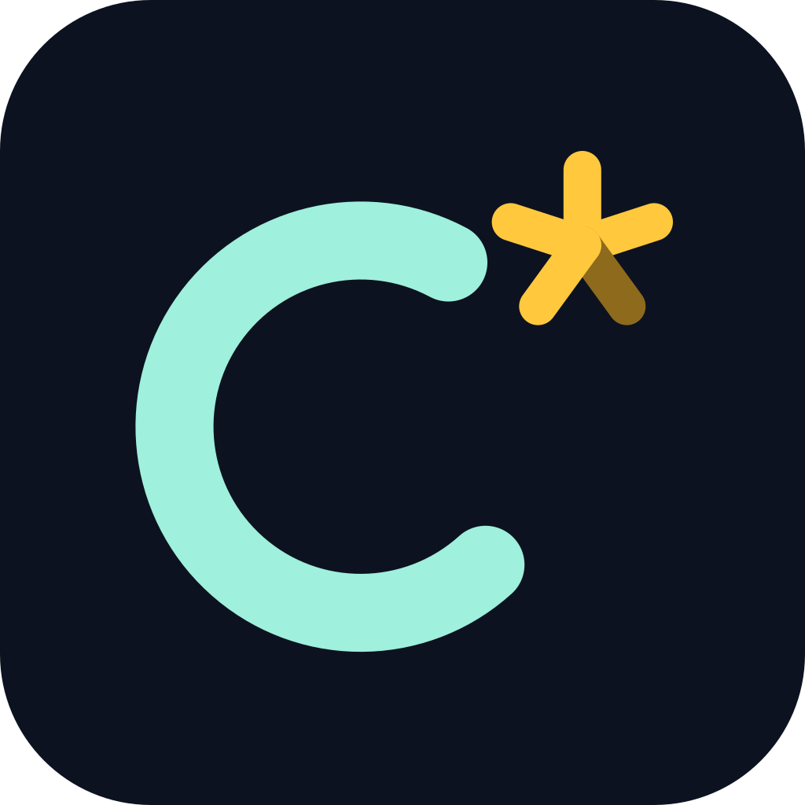

# Công ty C\*



Tên làm việc. Game web đơn theo cốt truyện, thể loại dark comedy, về nhân viên bị công ty nợ lương hơn sáu
tháng. Toàn bộ là hư cấu: mọi công ty, nhân vật và sự kiện đều do tưởng tượng, không phải thông tin thật và
không nhắm vào cá nhân hay tổ chức nào.

## Trạng thái

Chơi trọn được: 37 cảnh, 6 kết thúc, PWA offline, văn phòng 3D có ánh sáng bake, nhân vật có xương, chạy trên điện thoại, tablet và PC. Bản chạy thật: <https://c-star.lctuan.space>. Xem [.project/CURRENT.md](.project/CURRENT.md).

## Chạy dự án

### Cần có

- Node 24 (đúng bản trong `.nvmrc`, ví dụ `nvm use`).
- pnpm 11: `corepack enable` là đủ, phiên bản lấy từ `packageManager` trong `package.json`.
- Docker, chỉ khi cần chạy bản production hoặc phát hành.

Đồ họa dựng bằng Blender từ code, xem [tools/art-pipeline](tools/art-pipeline/README.md). Kết quả đã commit, không cần
Blender để chạy game.

### Chạy khi phát triển

```bash
pnpm install
pnpm dev
```

Mở <http://localhost:5200>. Server nghe trên `0.0.0.0`, nên điện thoại cùng mạng Wi-Fi mở được qua
`http://<IP-máy>:5200`. Bản dev không có service worker, muốn thử offline thì dùng bản build bên dưới.

### Kiểm tra

| Lệnh                | Việc                                                        |
| ------------------- | ----------------------------------------------------------- |
| `pnpm format:check` | Định dạng Prettier (`pnpm format` để sửa)                   |
| `pnpm typecheck`    | TypeScript toàn repo                                        |
| `pnpm lint`         | ESLint                                                      |
| `pnpm test`         | Vitest: game-core, content validator, web                   |
| `pnpm test:e2e`     | Build web rồi chạy Playwright trên điện thoại dọc và laptop |

Lần đầu chạy E2E cần `pnpm --filter @cstar/e2e exec playwright install chromium`. CI
([.github/workflows/ci.yml](.github/workflows/ci.yml)) chạy đúng các lệnh trên ở mỗi lần push lên `main`.

### Chạy bản build như production

Game là trang tĩnh, không có backend. Build ra `apps/web/out` (kèm `sw.js` để chơi offline):

```bash
pnpm build
pnpm --filter @cstar/web start
```

Mở <http://localhost:5201> (đổi cổng bằng biến `PORT`).

## Deploy

Bản công khai <https://c-star.lctuan.space> chạy trên máy owner:

```text
Người chơi ── HTTPS ──> Cloudflare ── Tunnel (cloudflared) ──> 127.0.0.1:6000 ──> Docker: nginx + apps/web/out
```

- [deploy/Dockerfile](deploy/Dockerfile): build trong `node:24`, rồi chép `apps/web/out` vào `nginx:alpine`.
- [deploy/nginx.conf](deploy/nginx.conf): MIME cho PWA, `sw.js` không cache, `/_next/static/` cache vĩnh viễn,
  `no-transform` để Cloudflare không chèn script analytics (BUG-001, trang `/policy` hứa không theo dõi).
- [deploy/docker-compose.prod.yml](deploy/docker-compose.prod.yml): chỉ mở cổng trên `127.0.0.1`, đường vào công
  khai duy nhất là tunnel. Đổi cổng bằng `WEB_PORT`.

### Lần đầu trên một máy mới

1. Cài Docker (có `docker compose`) và clone repo.
2. Cài `cloudflared`, tạo tunnel trong Cloudflare Zero Trust, trỏ hostname công khai về `http://localhost:6000`, cài
   thành service (`sudo cloudflared service install <token>`) để tự chạy khi khởi động máy.
3. Phát hành theo các bước dưới.

### Phát hành bản mới

Từ thư mục gốc repo, trên commit muốn phát hành (đã qua CI):

```bash
git pull
docker compose -f deploy/docker-compose.prod.yml up -d --build
```

Log build in dòng `sw.js: … files, … MB, version <hash>`. Sau khi container lên:

1. Xem `version` trong `https://c-star.lctuan.space/sw.js` có khớp với log build không. Không khớp nghĩa là site vẫn
   đang chạy bản cũ.
2. Chạy E2E thẳng vào site thật (dùng trình duyệt thật, không dùng `curl`: Cloudflare chỉ chèn script cho request giống
   trình duyệt):

   ```bash
   cd apps/e2e
   E2E_EXTERNAL_URL=https://c-star.lctuan.space pnpm exec playwright test tests/home.spec.ts tests/disclaimer.spec.ts tests/ending.spec.ts
   ```

   Lần chạy đầu ngay sau deploy có thể timeout ở trang chủ vì tunnel đang nạp file lần đầu, chạy lại trước khi coi là
   lỗi.

3. Ghi commit đang chạy công khai vào [.project/CURRENT.md](.project/CURRENT.md).

Người đang chơi không bị ngắt giữa cảnh: service worker mới nằm chờ, menu hiện lời mời cập nhật.

### Quay về bản cũ

```bash
git checkout <commit>
docker compose -f deploy/docker-compose.prod.yml up -d --build
```

### Khi site không vào được

- `docker compose -f deploy/docker-compose.prod.yml ps` và `… logs web`: container còn chạy không.
- `curl -I http://127.0.0.1:6000`: nginx có trả lời trên máy không.
- `systemctl status cloudflared`: tunnel còn chạy không.
- Máy tắt hoặc mất mạng thì site ngừng, chỉ người đã cài PWA còn chơi được.

## Tài liệu

- [GDD](docs/Cong_Ty_C_GDD_v0.1.md)
- [Roadmap](.project/roadmap.md)
- [Kiến trúc](.project/architecture/overview.md)
- [Quyết định](.project/decisions/)

## Quy trình

Làm theo [CLAUDE.md](CLAUDE.md), cùng flow với Alo Khách Ơi: Plan → Implement → Verify → Fix → Regression → Complete.

| Lệnh         | Việc                                           |
| ------------ | ---------------------------------------------- |
| `/plan`      | Tạo Task ID và tài liệu trong `.tasks/active/` |
| `/implement` | Làm task đang active                           |
| `/test`      | Chạy và ghi kết quả vào `test.md`              |
| `/review`    | Rà trước khi hoàn thành                        |
| `/fix`       | Sửa bug theo quy trình điều tra                |
| `/status`    | Xem tình trạng hiện tại                        |
| `/continue`  | Tiếp tục ở phiên mới                           |
